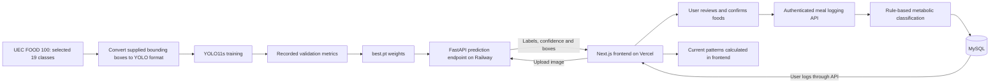

# myPCOS: AI-Enabled PCOS Health Support Web App

A full-stack research prototype for recording meals, symptoms and lifestyle behaviours and reviewing repeated behavioural associations. Users can upload a meal photo, review food labels suggested by a custom-trained YOLO11s model, correct them, and save a meal entry. A rule-based classifier adds a glycaemic band and metabolic summary.

Built as my MSc Software Engineering dissertation project at the University of Greater Manchester, 2026. The project covers dataset preparation, model training, API integration, application development, automated testing and cloud deployment. Its insights support behavioural awareness and are non-diagnostic.

Deployment addresses used for this project (current availability not checked in this review):

- Frontend: https://my-pcos-ai-app.vercel.app/
- Backend: https://mypcosaiapp-production.up.railway.app/
- Source: https://github.com/HenryJeremmy/myPCOS_AI_app

## Pipeline Overview



## Tech Stack

| Layer | Technologies |
| --- | --- |
| Frontend | Next.js, React, TypeScript, Tailwind CSS |
| Backend | Python, FastAPI, Uvicorn |
| Database | MySQL, SQLAlchemy, Alembic, PyMySQL |
| Authentication | JWT bearer tokens, pwdlib password hashing, email OTP verification |
| Email | Resend API integration; configurable SMTP alternative |
| Machine learning | Ultralytics YOLO11s, PyTorch |
| Image handling | Pillow, pillow-heif |
| Frontend testing | Vitest, React Testing Library, jsdom |
| Backend testing | Pytest, FastAPI TestClient, isolated SQLite test database |
| Delivery | Git, GitHub, GitHub Actions, Vercel frontend, Railway backend and MySQL |

## 1. Dataset

The source is **UEC FOOD 100**, confirmed by `dataset_raw/README.txt`. The dataset was released by the University of Electro-Communications' Yanai Laboratory: [official laboratory page](https://www.foodcam.mobi/e/). Its supplied annotations describe food bounding boxes; no separate use of Roboflow or LabelImg is established by the inspected files.

The 19 configured classes are Rice, Fried rice, Pizza toast, Spaghetti, Hamburger, Pizza, Sushi, Fried chicken, Sandwiches, French fries, Green Salad, Roll bread, Omelet, Beef steak, Hot dogs, Sausage, Croissant, Toast and Boiled fish.

`scripts/select_images.py` selects category images using `data/Food_Classes_Selection.xlsx`. `scripts/convert_to_yolo.py` remaps category IDs, converts pixel bounding boxes to normalised YOLO coordinates, and merges annotations sharing an image stem. Missing or unreadable images are skipped.

### Current Local Dataset Inventory

| Split | Image files |
| --- | ---: |
| Training | 4,530 |
| Validation | 1,307 |
| Test | 648 |
| Total file entries | 6,485 |

These are counts from the current local directories, not a verified manifest of the original Colab training run. **4,530 is the current training-folder count, not the total dataset size.**

A SHA-256 content audit found **3,029 distinct image contents** across these folders and **1,448 content groups present in more than one split**. There are 904 shared image contents between training and validation, 477 between training and test, and 151 between validation and test. These pairwise counts overlap and should not be added together.

The converter requests an approximately 70/20/10 split using `random_state=42`, but does not clear existing output directories before writing. Old outputs may therefore remain alongside later outputs. This is a possible contributor to the inventory mismatch; it does not establish the exact historical cause.

Before claiming independent evaluation, reconstruct a clean split grouped by original image identity/content and verify zero cross-split overlap. The present folders do not establish which images were used in the original recorded run.

Dataset configuration: `data.yaml`. Its current absolute local path must be adjusted when running on another machine.

## 2. Training

The saved `models/best.pt` checkpoint records the following settings:

| Setting | Value |
| --- | --- |
| Base model | `yolo11s.pt` |
| Pretrained setting | Enabled |
| Epochs configured | 50 |
| Image size | 640 |
| Batch size | 16 |
| Ultralytics version recorded | 8.4.23 |
| Checkpoint date | 17 March 2026 |
| Recorded output directory | `/content/runs/detect/train` |

The `/content` path is consistent with the reported Google Colab workflow. No training notebook or GPU model specification was found in this repository.

Checkpoint augmentation settings include mosaic (`1.0`, closed for the final 10 epochs), horizontal flipping (`0.5`), HSV shifts (`0.015 / 0.7 / 0.4`), translation (`0.1`) and scaling (`0.5`). Vertical flipping and MixUp are disabled.

The available training script is `scripts/train_model.py`. It currently specifies **batch size 8**, whereas the saved model records **16**. Use the checkpoint settings when describing that saved run; the current script is not an exact reproduction of it.

YOLO11s is the small model variant used in this project. No comparative latency benchmark against larger variants was found, so no measured speed advantage is claimed here.

## 3. Evaluation

The following are the validation metrics stored in the checkpoint's `train_metrics` field:

| Metric | Recorded value |
| --- | ---: |
| Precision | 88.812% |
| Recall | 91.872% |
| mAP@50 | 94.171% |
| mAP@50-95 | 81.945% |

These are **recorded validation results**, not newly reproduced results or a verified held-out test score. The current cross-split duplicates require investigation before using these numbers as evidence of generalisation. The local checkpoint and the backend's `app/ml_assets/best.pt` are byte-identical.

No evaluation plots or fresh passing test-run screenshot are included because those artifacts were not generated during this documentation review. After establishing a clean, independent dataset, evaluation can be run with:

```bash
yolo val model=models/best.pt data=data.yaml split=test
```

Running this command against the existing overlapping splits would not resolve the evaluation limitation. If the training data were contaminated, clean splitting and retraining would also be required.

## 4. Inference API

`FoodDetectorService`, in `backend/app/services/food_detector.py`, loads the weights lazily when prediction is requested. Inference uses a confidence threshold of **0.25**.

`POST /api/v1/ai/predict` accepts a multipart upload named `file`. The implementation:

- Accepts an allowed image MIME type or filename extension for JPEG, PNG, HEIC or HEIF, then attempts image decoding.
- Rejects uploads above 5 MiB after reading the upload into memory.
- Converts readable images to RGB and writes a temporary JPEG for inference.
- Removes the temporary file after the prediction attempt.
- Returns a controlled HTTP 503 when inference is disabled or required inference resources are unavailable.

From the model-training project directory, with the local backend running:

```bash
curl -X POST "http://127.0.0.1:8000/api/v1/ai/predict" \
  -F "file=@test_images/1_66.jpg"
```

The response contains `filename`, `content_type`, `total_detections` and `detections`. Each detection contains `class_id`, `label`, `confidence` and a `bbox` object with `x1`, `y1`, `x2` and `y2`. Bounding boxes are not arrays in this implementation.

The draft's example confidence values and coordinates were not a captured response and have been removed. The prediction route currently has no authentication dependency; the bearer-token requirement applies to protected account and logging routes.

## 5. Authentication and Application Features

The application supports signup, OTP email verification, login, session restoration, profile updates, password changes and account deletion. Protected logging routes scope records to the authenticated user. The frontend waits for authentication initialisation before redirecting protected pages.

There are **17 explicit routes under `/api/v1`**, plus a root welcome route, in the inspected application code. Automatic documentation routes are excluded from this count.

| Group | Routes under `/api/v1` |
| --- | --- |
| Authentication and account | `POST /auth/signup`, `POST /auth/verify-email`, `POST /auth/resend-otp`, `POST /auth/login`, `GET /auth/me`, `PUT /auth/profile`, `POST /auth/change-password`, `DELETE /auth/delete-account` |
| Logging | `GET` and `POST` on each of `/logs/meals`, `/logs/symptoms`, `/logs/lifestyle` |
| AI | `POST /ai/predict`, `GET /ai-test/predict` |
| Health | `GET /health` |

Dashboard summaries and insights are calculated in the frontend from fetched logs; there are no dedicated dashboard or insights API routes in the inspected backend.

The insight logic analyses recent seven-day records and counts symptom entries associated with qualifying behaviours within a 12-hour window. Behaviours include glycaemic meal categories, sleep under six hours and high stress. Associations with at least three counted occurrences are displayed. The current comparison allows equal behaviour and symptom timestamps. Insights are recalculated and are not saved as historical insight records.

## 6. Prototyping, Testing and CI

`scripts/run_best_model_check.py` provides a small standalone prediction check. The separate `/api/v1/ai-test/predict` route exercises inference on a fixed image independently of the frontend. That development route still uses a machine-specific image path.

Backend test files cover authentication, profile/account operations, log creation, history retrieval, user isolation and health responses. Frontend test files cover authentication routing, dashboard rendering, logging forms, image upload interactions, history filters, insights and settings. Existing tests establish test coverage intent; this review did not run the suites or establish a test-first development chronology.

Run the backend tests from the web-app repository:

```bash
cd /Users/henrychijioke/myPCOS_web_app/backend
source venv/bin/activate
DEMO_OTP_ENABLED=true PYTHONPATH=. pytest -q
```

Run the frontend tests in a separate terminal:

```bash
cd /Users/henrychijioke/myPCOS_web_app/frontend
npm run test -- --run
```

The inspected web-app GitHub Actions workflow runs backend tests on pushes and pull requests targeting `main` and `dev`, using Python 3.11. It does not currently run the frontend suite.

## 7. Running Locally

For the existing local checkout and installed virtual environment:

```bash
cd /Users/henrychijioke/myPCOS_web_app/backend
source venv/bin/activate
uvicorn app.main:app --reload
```

In another terminal:

```bash
cd /Users/henrychijioke/myPCOS_web_app/frontend
npm install
npm run dev
```

Open `http://localhost:3000` for the frontend and `http://127.0.0.1:8000/docs` for Swagger UI.

The backend needs a configured database and migrated schema. Check the existing local `.env` for `DATABASE_URL`, `JWT_SECRET_KEY`, `CORS_ORIGINS`, email settings and `AI_INFERENCE_ENABLED`. The local MySQL service must be running if that is the configured database. Apply pending schema migrations with `alembic upgrade head` against the intended local database. For local AI inference, enable the flag and ensure model weights and dependencies are available.

Set frontend `NEXT_PUBLIC_API_BASE_URL=http://127.0.0.1:8000` for local API access. No `backend/.env.example` was found, so the draft's command to copy that file has been removed.

## 8. Deployment and Lessons Learned

The project's deployment uses **Vercel for the frontend** and **Railway for the backend and MySQL**. Backend model weights are located at `app/ml_assets/best.pt`. Inference can be enabled through `AI_INFERENCE_ENABLED=true`; resources and dependencies must also be available.

Concrete implementation lessons included replacing machine-specific model paths with configurable defaults, deferring model loading so the core API can start independently, using headless OpenCV in deployment, and checking pooled MySQL connections before reuse. Resend was integrated after SMTP connectivity failed in the hosted environment.

The current prototype's limitations include its restricted food vocabulary, approximate rule-based metabolic categories, no portion-size estimation, and no saved insight history. A priority for further model evaluation is resolving dataset overlap and documenting reproducible training and test manifests. These are future improvements, not completed features.

## Author

Henry Chijioke Jeremiah - [GitHub](https://github.com/HenryJeremmy)

## Evidence Note

Prepared on 13 October 2026 from the current source files, image directories and saved checkpoint metadata. The degree/institution description and deployment addresses originate from the supplied project description and earlier project context. Current hosting availability, academic marks, hardware details, inference latency and user-study scores were not independently verified for this document and are not asserted as new findings.
